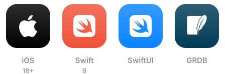
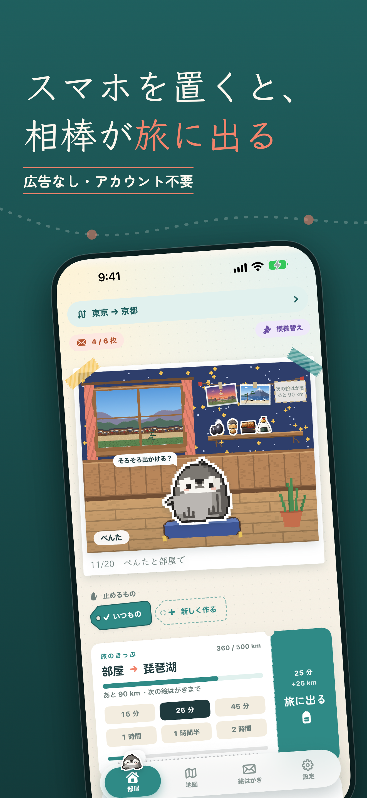
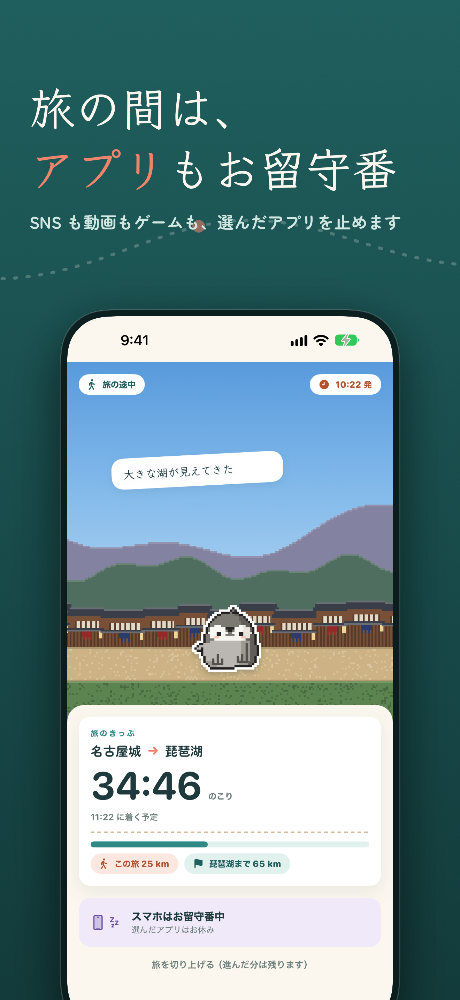
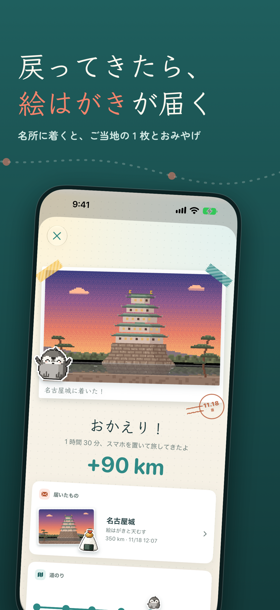
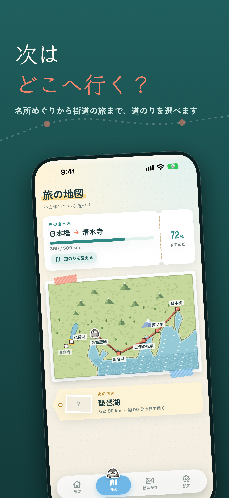
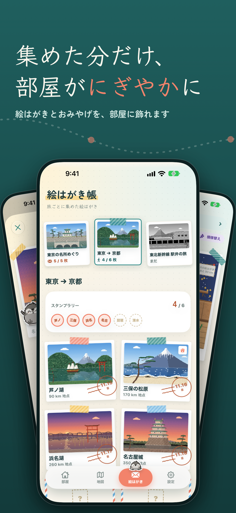
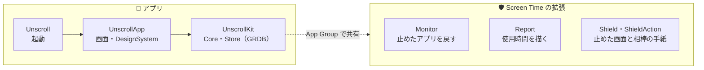

# おるすマホ（Unscroll）

スマホを触りすぎる人が、集中した分だけ相棒に日本を旅させて SNS を断つアプリ。

## ✨ 機能

| 相棒の部屋 | 旅の間はアプリを止める | 絵はがきとおみやげ |
| :---: | :---: | :---: |
|  |  |  |

| 旅の地図 | 絵はがき帳 |
| :---: | :---: |
|  |  |

## 🗺️ 全体像

| 部分 | 中身 |
| --- | --- |
| パッケージとフォルダ | [ios-architecture.md](https://github.com/yossibank/claude-config/blob/main/docs/app/ios-architecture.md)（claude-config） |
| 画面のモデル・ドット絵・拡張・権限 | [docs/architecture.md](docs/architecture.md) |

## 💻 実行環境

| 対象 | 🍎 iOS |
| --- | --- |
| 対応 OS | iOS 18 以上 |
| 言語 | Swift 6 |
| 開発の道具 | Xcode、Homebrew |

[make のコマンド（claude-config の ios-architecture.md）](https://github.com/yossibank/claude-config/blob/main/docs/app/ios-architecture.md#-動かし方)

## 📚 文書

| 知りたいこと | 文書 |
| --- | --- |
| 何を作るか | [docs/overview.md](docs/overview.md) |
| 作る順番と画面 | [docs/roadmap.md](docs/roadmap.md) |
| 共通の形から外れた構成 | [docs/architecture.md](docs/architecture.md) |
| 複数の画面で使う仕組み | [docs/architecture-parts.md](docs/architecture-parts.md) |
| 相棒の絵の決定 | [docs/decisions/companion.md](docs/decisions/companion.md) |
| 名所の絵はがきとおみやげの決定 | [docs/decisions/landmark.md](docs/decisions/landmark.md) |
| 止めた画面と外しにくさの決定 | [docs/decisions/shield.md](docs/decisions/shield.md) |
| フォルダと依存の向き | [ios-architecture.md](https://github.com/yossibank/claude-config/blob/main/docs/app/ios-architecture.md)（claude-config） |
| 画面の組み立て | [ios-screens.md](https://github.com/yossibank/claude-config/blob/main/docs/app/ios-screens.md)（claude-config） |
| 作業と文書の決まり | [CLAUDE.md](CLAUDE.md) |
| 全リポジトリ共通の決まり | [claude-config](https://github.com/yossibank/claude-config) |

## 🔤 フォント

| 字体 | フォント | 見本 | 著作権者 | ライセンス |
| --- | --- | --- | --- | --- |
| 見出し | [Zen Maru Gothic](https://github.com/googlefonts/zen-marugothic) |  | The Zen Maru Gothic Project Authors | [OFL 1.1](https://openfontlicense.org/) |
| 手書き | [Klee One](https://github.com/fontworks-fonts/Klee) |  | The Klee Project Authors | [OFL 1.1](https://openfontlicense.org/) |
