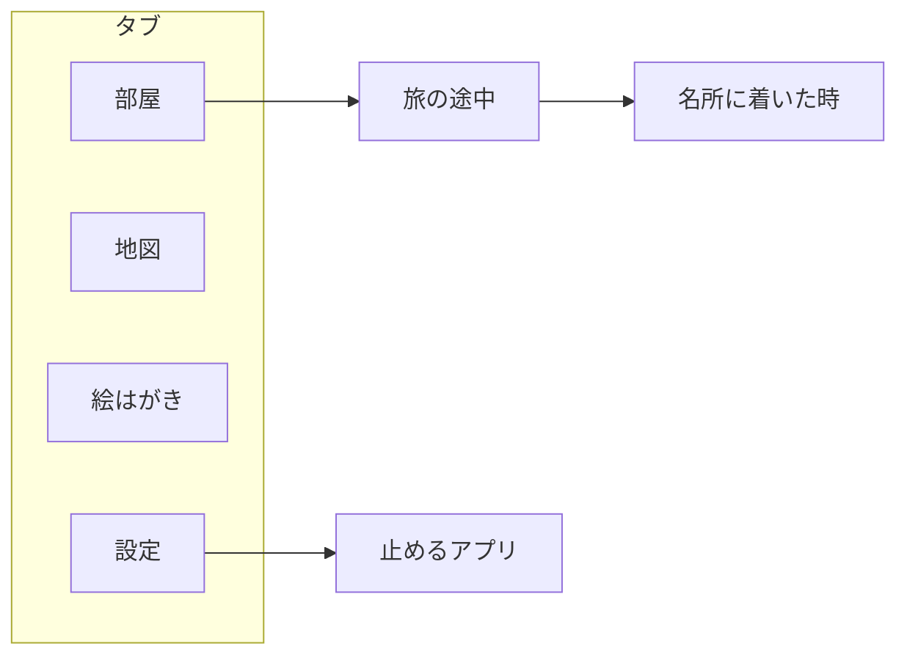

# 画面と作る順番

> [!NOTE]
> Unscroll を作る順番と、その状態、作る画面、この先の段階と収益化が分かる。
> 最初のリリースの機能は [overview](overview.md) にある。

## 🗓️ 作る順番

状態は ✅ 完了、🚧 作業中、⬜ 未着手で書く。

| 順 | 中身 | OS | 状態 |
| --- | --- | --- | --- |
| 0 | 土台と、実機での Screen Time の試作 | 🍎 iOS | ✅ 完了 |
| 1 | 旅と止めるアプリ | 🍎 iOS | ⬜ 未着手 |
| 2 | 地図・距離・絵はがき | 🍎 iOS | ⬜ 未着手 |
| 3 | 相棒の選び方と部屋 | 🍎 iOS | ⬜ 未着手 |
| 4 | 外しにくさと止めた画面 | 🍎 iOS | ⬜ 未着手 |
| 5 | ストアの準備と公開 | 🍎 iOS | ⬜ 未着手 |

## 💰 この先の段階と収益化

最初のリリースの後に、足していく機能と収益の形を並べる。

| 段階 | 機能 | 収益 |
| --- | --- | --- |
| 最初のリリース | [overview](overview.md#-最初のリリースの機能) の表 | 無料 |
| 次の更新 | ロック画面の Live Activity、ウィジェット | 無料 |
| その次 | 道のりの追加（北海道一周、四国の札所めぐり） | 買い切りか月額（未決） |
| その次 | 相棒の追加、着せ替え | 買い切り（未決） |
| その次 | 子ども向け（親が許可し、決めたアプリだけ使わせる） | 月額（未決） |

## 📱 画面

画面は、タブと、そこから開く画面に分かれる。

| 画面 | 中身 |
| --- | --- |
| 部屋 | 相棒、飾った絵はがき、次の名所までの距離、旅の長さを選んで旅に出す |
| 地図 | 道のり、今の位置、通った名所のスタンプ、次の名所 |
| 絵はがき | 道のりごとの絵はがきの図鑑。まだの名所は残りの距離を出す |
| 設定 | 相棒、止めるアプリ、外しにくさ |
| 旅の途中 | 残り時間、次の名所までの距離、切り上げる |
| 名所に着いた時 | 絵はがき、おみやげ、部屋に飾る |
