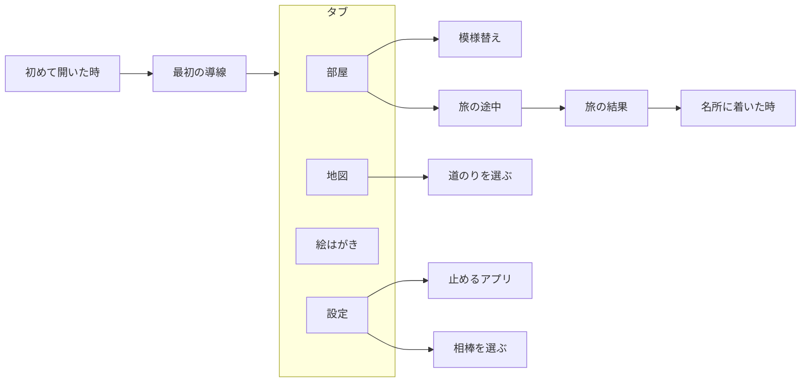

# 画面と作る順番

> [!NOTE]
> Unscroll を作る順番と、その状態、作る画面、この先の段階と収益化が分かる。
> 最初のリリースの機能は [overview](overview.md) にある。

## 🗓️ 作る順番

状態は ✅ 完了、🚧 作業中、⬜ 未着手で書く。

| 順 | 中身 | OS | 状態 |
| --- | --- | --- | --- |
| 0 | 土台と、実機での Screen Time の試作 | 🍎 iOS | ✅ 完了 |
| 1 | 旅と止めるアプリ | 🍎 iOS | ✅ 完了 |
| 2 | 地図・距離・絵はがき | 🍎 iOS | ✅ 完了 |
| 3 | 相棒の選び方と部屋 | 🍎 iOS | ✅ 完了 |
| 4 | 外しにくさと止めた画面 | 🍎 iOS | ✅ 完了 |
| 5 | 道のりの追加と、道のりを選ぶ画面 | 🍎 iOS | ✅ 完了 |
| 6 | 最初の導線 | 🍎 iOS | ✅ 完了 |
| 7 | ストアの準備と公開 | 🍎 iOS | ⬜ 未着手 |

## 💰 この先の段階と収益化

最初のリリースの後に、足していく機能と収益の形を並べる。

| 段階 | 機能 | 収益 |
| --- | --- | --- |
| 最初のリリース | [overview](overview.md#-最初のリリースの機能) の表 | 無料 |
| 次の更新 | ロック画面の Live Activity、ウィジェット | 無料 |
| 声があれば | 毎日の約束（1 日の使用量の管理。選んだアプリを決めた時間使うと、日付が変わるまで止める） | 無料 |
| その次 | 相棒の追加、着せ替え | 買い切り（未決） |
| その次 | 子ども向け（親が許可し、決めたアプリだけ使わせる） | 月額（未決） |

## 📱 画面

画面は、タブと、そこから開く画面に分かれる。

| 画面 | 中身 |
| --- | --- |
| 最初の導線 | 相棒がまだいない時に出す。説明 4 枚は払うか「とばす」で進み、支度 3 枚の許可と止めるアプリは「あとで設定する」で飛ばせる |
| 相棒を選ぶ | 設定から開き、キャラクター・毛の色を絵の札で、名前を文字で選んで、部屋の座布団の上の姿で確かめる |
| 部屋 | テープで留めた写真に、窓の景色・吊るした絵はがき・棚のおみやげ・座布団の上の相棒（夜は暗い）。旅のきっぷに次の名所までの距離と旅の長さを並べ、半券を押すと旅に出る |
| 模様替え | 部屋の上の行から、半分の高さのシートで開く。壁・床・絵はがきを選ぶと、上の部屋がその場で変わる |
| 地図 | 旅のきっぷに区間と進んだ割合、貼ったドット絵の地図に道のりと相棒、荷札に次の名所までの距離。きっぷの「道のりを替える」で道のりを選ぶシートを開く（旅の途中は押せない） |
| 道のりを選ぶ | 絵はがきがそろった道のりの札に、km・名所の数・集中の時間と、進んだ km を出す。選ぶと下に名所の並びが出て、「この道のりにする」で替える |
| 絵はがき | 道のりごとの絵はがきの図鑑。まだの名所は残りの距離を出す |
| 設定 | 相棒のパスポートと進んだ km、見出しシールのページに止めるアプリと許可、外しにくさの 3 つのスタンプ。許可か止めるアプリが足りない時は、上に準備の札を出す |
| 旅の途中 | 次の名所へ向かう道の流れる景色と相棒、残り時間、次の名所までの距離、切り上げる |
| 旅の結果 | 着いた名所の絵はがきか道の景色と相棒、進んだ距離、届いた絵はがきとおみやげ、道のりの線、次の名所、部屋に戻る |
| 名所に着いた時 | 絵はがき、おみやげ、部屋に飾る |
